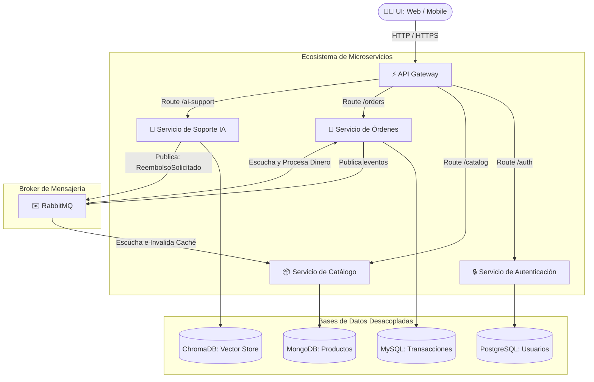
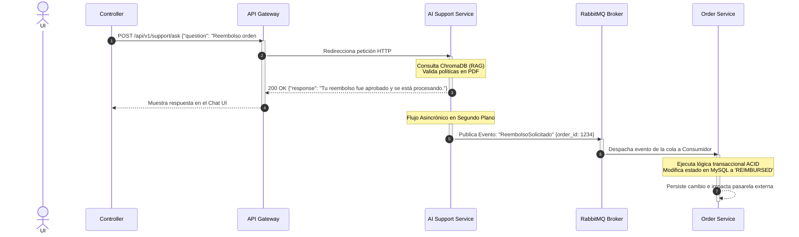
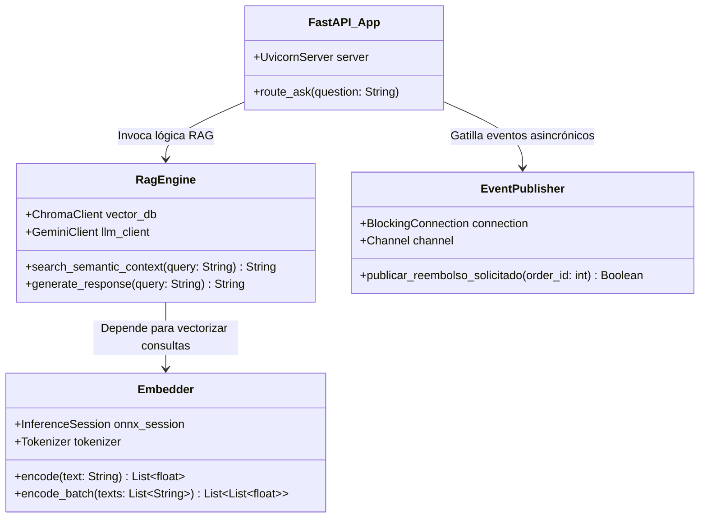
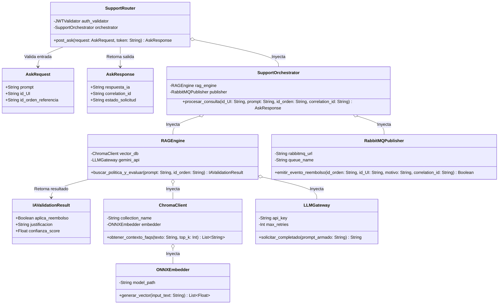
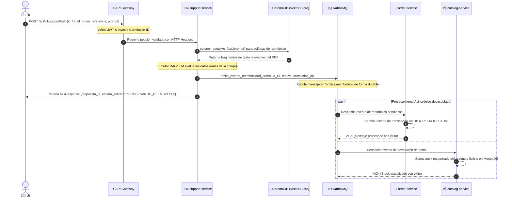
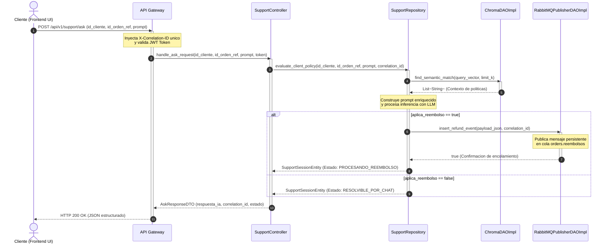

# BimBam Buy Sistema Distribuido con Soporte IA - Especificación de Diseño de Sistemas (HLD / LLD)

Este documento detalla la arquitectura de microservicios distribuida para la plataforma **BimBam Buy**, combinando un motor de e-commerce transaccional con un agente de soporte basado en IA (RAG).

---

## 🌐 1. High-Level Design (HLD)

El High-Level Design describe los límites de los componentes distribuidos, la estrategia de persistencia aislada y la topología de comunicación sincrónica/asincrónica a través de la red.

### 🏗️ Diagrama de Rabbit MQ Arquitectura Global (Macro)



### 🔄 Diagrama de Secuencia (DSD) - Flujo de Reembolso Automatizado por IA

Este diagrama detalla la interacción temporal asincrónica cuando un UI solicita un reembolso al bot de soporte inteligente:



---

## 🔎 2. Low-Level Design (LLD)

El Low-Level Design expone la distribución física exacta de archivos bajo una estrategia Monorepo y la estructura de clases/módulos para el procesamiento interno.

### 📂 Estructura General del Monorepo (5 Archivos Esenciales por Servicio)

```JavaScript
bimbam-buy-monorepo/
├── infra/
│   └── docker-compose.yml         # Orquestación de infraestructura local
├── services/
│   ├── ai-support-service/        # [Python / FastAPI]
│   │   ├── app.py                 # API Entrypoint & ruteo
│   │   ├── rag_engine.py          # Orquestador LangChain & ChromaDB
│   │   ├── embedder.py            # Tokenizador e inferencia ONNX (CPU)
│   │   ├── publisher.py           # Productor de eventos RabbitMQ (Pika)
│   │   └── Dockerfile             # Contenedor optimizado python-slim
│   │
│   ├── catalog-service/           # [Node.js / Express]
│   │   ├── server.js              # Servidor HTTP Express
│   │   ├── db.js                  # Driver de conexión a MongoDB
│   │   ├── productos.js           # Lógica de catálogo y stock
│   │   ├── consumer.js            # Consumidor de eventos (Restar Stock)
│   │   └── Dockerfile             # Contenedor Node runtime
│   │
│   ├── order-service/             # [Node.js / .NET / Python]
│   │   ├── server.js              # Servidor HTTP transaccional
│   │   ├── db.js                  # Conexión ACID a PostgreSQL/MySQL
│   │   ├── orders.js              # Lógica de estados de órdenes
│   │   ├── consumer.js            # Consumidor de eventos (Procesar Reembolso)
│   │   └── Dockerfile             # Contenedor transaccional aislado
│   │
│   └── auth-service/              # [Node.js / Express]
│       ├── server.js              # Rutas exclusivas login/registro
│       ├── db.js                  # Conexión a base de credenciales
│       ├── usuarios.js            # Validación de payload e identidades
│       ├── hashMaster.js          # Encriptación BCrypt y firma JWT
│       └── Dockerfile             # Contenedor liviano de seguridad
└── README.md
```


### 📐 Diagrama de Componentes / Clases (DCD) - `microservices`

classDiagram
    class AskRequest {
        +String prompt
        +String id_UI
        +String id_orden_referencia
    }

    class AskResponse {
        +String respuesta_ia
        +String correlation_id
        +String estado_solicitud
    }

    class SupportRouter {
        -JWTValidator auth_validator
        -SupportOrchestrator orchestrator
        +post_ask(request: AskRequest, token: String) AskResponse
    }

    class SupportOrchestrator {
        -RAGEngine rag_engine
        -RabbitMQPublisher publisher
        +procesar_consulta(id_UI: String, prompt: String, id_orden: String, correlation_id: String) AskResponse
    }

    class RAGEngine {
        -ChromaClient vector_db
        -LLMGateway gemini_api
        +buscar_politica_y_evaluar(prompt: String, id_orden: String) IAValidationResult
    }

    class IAValidationResult {
        +Boolean aplica_reembolso
        +String justificacion
        +Float confianza_score
    }

    class ChromaClient {
        -String collection_name
        -ONNXEmbedder embedder
        +obtener_contexto_faqs(texto: String, top_k: Int) List~String~
    }

    class ONNXEmbedder {
        -String model_path
        +generar_vector(input_text: String) List~Float~
    }

    class LLMGateway {
        -String api_key
        -Int max_retries
        +solicitar_completado(prompt_armado: String) String
    }

    class RabbitMQPublisher {
        -String rabbitmq_url
        -String queue_name
        +emitir_evento_reembolso(id_orden: String, id_UI: String, motivo: String, correlation_id: String) Boolean
    }

    %% Relaciones estructurales de composición e inyección
    SupportRouter --> AskRequest : Valida entrada
    SupportRouter --> AskResponse : Retorna salida
    SupportRouter o-- SupportOrchestrator : Inyecta
    SupportOrchestrator o-- RAGEngine : Inyecta
    SupportOrchestrator o-- RabbitMQPublisher : Inyecta
    RAGEngine --> IAValidationResult : Retorna resultado
    RAGEngine o-- ChromaClient : Inyecta
    RAGEngine o-- LLMGateway : Inyecta
    ChromaClient o-- ONNXEmbedder : Inyecta


### 📐 Diagrama de Componentes / Clases (DCD) - `RAG-support-service`

Zoom estructural de cómo interactúan las abstracciones internas en el microservicio de Inteligencia Artificial:



---

## 🚀 Tecnologías y Justificación de Escalabilidad

1. **RabbitMQ (Mensajería Asincrónica):** Garantiza resiliencia. Si el microservicio de órdenes sufre latencia alta en su DB relacional, el sistema de soporte IA no se congela ni pierde la solicitud; el mensaje queda respaldado de forma segura en la cola.
2. **Estrategia Políglota de Persistencia:** Cada servicio escala de acuerdo a su patrón de acceso a datos (Lecturas masivas en MongoDB para Catálogo, Vectores en ChromaDB para IA, y consistencia estricta en MySQL para Dinero).
3. **Despliegue Independiente (Docker):** Permite escalabilidad horizontal selectiva. Ante un incremento masivo en consultas de IA, es posible clonar instancias de `ai-support-service` a través del Gateway sin necesidad de redimensionar o pagar infraestructura extra para el resto del sistema.


### 🤖 Microservicio de Soporte IA (`ai-support-service`)
1. **`app.py`**: Servidor FastAPI que expone los endpoints REST para el chat de asistencia de los compradores.
2. **`rag_engine.py`**: Motor LangChain que ejecuta las búsquedas semánticas sobre los manuales y políticas de BimBam Buy.
3. **`embedder.py`**: Procesador local encargado de transformar el texto en arrays numéricos utilizando un modelo ONNX por CPU.
4. **`publisher.py`**: Emisor asincrónico que inyecta el evento `ReembolsoSolicitado` en la cola de RabbitMQ cuando la IA aprueba una solicitud.
5. **`Dockerfile`**: Configuración de la imagen basada en `python:3.11-slim` optimizada para el cómputo de inferencia local.

### 📦 Microservicio de Catálogo (`catalog-service`)
1. **`server.js`**: Servidor Express que gestiona el ruteo público de los productos fantásticos del e-commerce.
2. **`db.js`**: Driver y pool de conexiones directo hacia la base de datos documental MongoDB.
3. **`productos.js`**: Controlador de negocio encargado de procesar listados, precios mutables e inventarios.
4. **`consumer.js`**: Listener asincrónico que procesa los mensajes del broker para decrementar o incrementar el stock físico remanente.
5. **`Dockerfile`**: Definición del contenedor Node.js para despliegues dinámicos bajo demanda de tráfico de navegación.

### 🛒 Microservicio de Órdenes (`order-service`)
1. **`server.js`**: Punto de entrada de la API transaccional para iniciar los flujos de checkout, carritos y reembolsos financieros.
2. **`db.js`**: Configuración de la persistencia ACID utilizando un ORM conectado a MySQL o PostgreSQL.
3. **`orders.js`**: Controlador que gestiona los estados de los pedidos (`CREADA`, `PAGADA`, `REEMBOLSADA`, `ERROR`).
4. **`consumer.js`**: Listener que procesa las aprobaciones dictaminadas por la IA para modificar los saldos contables de forma asíncrona.
5. **`Dockerfile`**: Contenedor dedicado a los procesos críticos de facturación y auditoría del dinero del negocio.

### 🔒 Microservicio de Autenticación (`auth-service`)
1. **`server.js`**: Servidor que aisla los endpoints de registro, renovación de sesiones e inicio de sesión de UIs.
2. **`db.js`**: Módulo de persistencia exclusivo para la tabla indexada de credenciales e identidades.
3. **`usuarios.js`**: Controlador encargado de coordinar flujos de perfiles, firmas y asignación de roles.
4. **`hashMaster.js`**: Utilidad de criptografía interna encargada de hashear claves con BCrypt y emitir firmas de tokens JWT.
5. **`Dockerfile`**: Imagen ligera Node.js para mitigar de forma aislada los vectores de ataque distribuidos (DDoS) al login.


### 📐 Diagrama de Clases de Diseño (DCD) - `ai-support-service`
A continuación se modelan las clases reales del componente de IA, detallando sus tipos de datos primitivos, variables críticas del e-commerce y estructuras de retorno exactas.



### ⏱️ Diagrama de Secuencia de Diseño (DSD) - Flujo de Reembolso Automatizado
Este diagrama de secuencia ilustra el ciclo de vida completo de una solicitud de reembolso transaccional iniciada por un usuario desde la interfaz de soporte de IA:



---




---

## 📈 4. Análisis de Viabilidad y Criterios de Escalabilidad

* **Resiliencia ante Fallas en Cascada:** Al responderle al UI en el paso 9 del DSD con un estado intermedio diferido, el hilo HTTP se libera inmediatamente. Si el `order-service` o el clúster transaccional sufren un corte o lentitud, las colas de RabbitMQ retienen los mensajes de forma durable garantizando la consistencia eventual sin arrojar errores HTTP 500 al frontend.
* **Escalabilidad Horizontal Selectiva:** El consumo de hardware del pipeline de embeddings (`ONNXEmbedder`) se aísla por completo del backend tradicional. Docker puede instanciar múltiples replicas de `ai-support-service` tras el API Gateway bajo picos de uso sin alterar el consumo de memoria del catálogo o de los procesos de autenticación de la compañía.